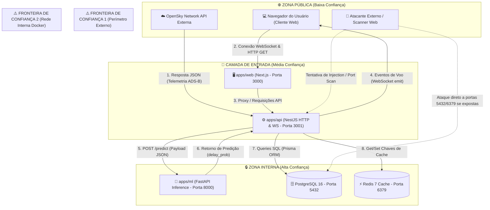

# Etapa 1 — Modelagem de Ameaças (Threat Modeling com STRIDE)

> **Projeto:** REC Flight Intelligence  
> **Data:** Novembro de 2026  
> **Metodologia:** STRIDE (Microsoft Threat Modeling)  
> **Classificação de Risco:** Rastreabilidade vinculada a `docs/security/vulnerabilidades.md`  

---

## 1. O que é Modelagem de Ameaças e por que ela é Vital no DevSecOps?

A **Modelagem de Ameaças** (*Threat Modeling*) é a engenharia reversa do pensamento de um atacante. Em vez de esperar um incidente de segurança ocorrer em produção ou depender exclusivamente de scanners automatizados, o time de engenharia se antecipa para responder a quatro perguntas essenciais:

1. **No que estamos trabalhando?** (Decomposição do sistema em componentes e fluxos de dados).
2. **O que pode dar errado?** (Mapeamento sistemático de ameaças usando o método STRIDE).
3. **O que faremos a respeito?** (Definição dos controles de segurança e contramedidas).
4. **Fizemos um bom trabalho?** (Validação automatizada no CI/CD e testes de regressão).

No DevSecOps, a modelagem de ameaças representa o ápice do **Shift-Left**: custa centavos corrigir um desenho arquitetural inseguro no papel, enquanto corrigir uma falha estrutural após o deploy pode custar milhares de reais e a reputação da empresa.

---

## 2. Diagrama de Fluxo de Dados (DFD) e Fronteiras de Confiança

Para identificar ameaças, precisamos delimitar as **Fronteiras de Confiança** (*Trust Boundaries*). Uma fronteira de confiança é a linha imaginária onde os dados saem de uma zona de menor privilégio ou menor controle para uma zona mais confiável.

### Diagrama de Fluxo e Fronteiras (DFD Nível 1)



---

## 3. Análise Detalhada STRIDE para o REC Flight Intelligence

A metodologia **STRIDE** divide as ameaças em 6 categorias fundamentais:

| Letra | Categoria | Pergunta Central do Atacante | Propriedade de Segurança Violada |
| :---: | :--- | :--- | :--- |
| **S** | **S**poofing | *"Posso fingir ser alguém ou algum serviço legítimo?"* | **Autenticidade** |
| **T** | **T**ampering | *"Posso adulterar os dados em trânsito ou no disco?"* | **Integridade** |
| **R** | **R**epudiation | *"Posso realizar uma ação crítica e negar que fui eu?"* | **Não-repúdio** |
| **I** | **I**nformation Disclosure | *"Posso ler dados confidenciais aos quais não deveria ter acesso?"* | **Confidencialidade** |
| **D** | **D**enial of Service | *"Posso derrubar o sistema ou torná-lo indisponível?"* | **Disponibilidade** |
| **E** | **E**levation of Privilege | *"Posso obter permissões superiores (como root ou admin)?"* | **Autorização** |

---

### 3.1. Spoofing (Falsificação de Identidade)

* **Cenário de Ameaça S1:** Um atacante intercepta ou emula a API externa da OpenSky enviando telemetria ADS-B forjada com aeronaves inexistentes ou dados de colisão falsos sobre o Aeroporto dos Guararapes (REC).
  * **Impacto:** O painel de controle e o radar do aeroporto passam a exibir alertas fantasmas de aproximação ou atrasos irreais, causando pânico operacional.
  * **Contramedida DevSecOps:**
    1. Validação estrita de coordenadas geográficas através de *Bounding Box* rígido em torno do Recife (`-8.1268, -34.9228`).
    2. Sanitização e validação de schema rigorosa (via `class-validator` / DTOs do NestJS) descartando payloads fora do formato canônico.

* **Cenário de Ameaça S2:** Um cliente web forja o identificador de voo ou se inscreve em salas WebSocket arbitrárias (`flight:XXX`) simulando ser um operador homologado.
  * **Contramedida DevSecOps:** Validação dos parâmetros recebidos no evento `join:room` do `flights.gateway.ts`.

---

### 3.2. Tampering (Adulteração de Dados)

* **Cenário de Ameaça T1:** Manipulação de parâmetros de requisição entre a API NestJS e o serviço de Machine Learning (`POST http://ml:8000/predict`).
  * **Impacto:** O cálculo de probabilidade de atraso é adulterado, mascarando voos em atraso crítico.
  * **Contramedida DevSecOps:** O tráfego entre NestJS e FastAPI deve ocorrer estritamente na rede privada isolada do Docker (`flight-network`), sem jamais passar pela interface de rede pública do host.

* **Cenário de Ameaça T2:** Substituição maliciosa do arquivo de pesos do modelo de Machine Learning (`model.joblib`).
  * **Impacto:** Como o Python utiliza `joblib.load()`, a desserialização de um arquivo `.joblib` adulterado permite **Execução Remota de Código (RCE)** arbitrária dentro do container.
  * **Contramedida DevSecOps:**
    1. Calcular o hash SHA-256 do arquivo `model.joblib` durante o build da imagem Docker.
    2. No startup da API FastAPI (`apps/ml/app/main.py`), verificar se o hash do arquivo em disco coincide exatamente com o hash esperado antes de chamar `joblib.load()`.
    3. Montar o diretório de modelos com permissão estrita de leitura (`read-only`).

---

### 3.3. Repudiation (Repúdio)

* **Cenário de Ameaça R1:** Um voo entra em aproximação crítica, o sistema falha em disparar o alerta sonoro/visual, e os engenheiros não têm como provar se a falha ocorreu na ingestão da OpenSky, no processamento da API ou na entrega via WebSocket.
  * **Impacto:** Impossibilidade de realizar análise pós-incidente (*Post-Mortem*) e identificação de responsabilidades.
  * **Contramedida DevSecOps:**
    1. Implementação de **Correlation IDs** (ou `x-request-id`) repassados em cascata entre `apps/web` ➔ `apps/api` ➔ `apps/ml`.
    2. Log estruturado em JSON com timestamps UTC de alta precisão (ISO 8601) registrando cada transição de estado da aeronave (`departed`, `approach`, `landed`).

---

### 3.4. Information Disclosure (Vazamento de Informações)

* **Cenário de Ameaça I1:** Varredura externa de portas abertas (Shodan / Censys / Nmap) acessando diretamente o PostgreSQL (`5432`) ou o Redis (`6379`) expostos no `docker-compose.yml`.
  * **Impacto:** Como as credenciais padrão no código eram `rec:rec` e o Redis não possuía senha, um atacante consegue baixar todo o histórico de voos e esvaziar ou adulterar o cache da aplicação com comandos como `FLUSHALL`.
  * **Contramedida DevSecOps (Item `SEC-002`):**
    1. **Eliminar o mapeamento de portas host no Compose de produção:** O banco de dados e o cache devem escutar apenas dentro da rede interna do Docker (`expose: - "5432"` em vez de `ports: - "5432:5432"`).
    2. Habilitar obrigatoriamente autenticação no Redis com `--requirepass`.
    3. Segregação rigorosa de segredos em arquivos `.env` ignorados pelo Git.

* **Cenário de Ameaça I2:** Vazamento de stack trace completo de erros do NestJS ou FastAPI para clientes externos.
  * **Contramedida DevSecOps:** Filtro de exceção global (`GlobalExceptionFilter`) que retorna apenas mensagens padronizadas em produção (`Internal Server Error`), gravando os detalhes técnicos estritamente nos logs internos.

---

### 3.5. Denial of Service (Negação de Serviço)

* **Cenário de Ameaça D1:** Um cliente malicioso abre centenas de conexões simultâneas no WebSocket (`ws://localhost:3001/socket.io`) ou inunda o endpoint `/predict` com requisições pesadas de inferência.
  * **Impacto:** Esgotamento do Event Loop do Node.js ou do worker do Uvicorn/FastAPI, tornando o painel de voos inoperante para os operadores do aeroporto.
  * **Contramedida DevSecOps:**
    1. Adicionar **Rate Limiting** via `@nestjs/throttler` na API NestJS (ex: limite de 60 requisições/min por IP).
    2. Configurar limitação de conexões ativas por socket e timeout agressivo de conexões ociosas.
    3. Caching de predições no Redis para evitar inferências repetidas para o mesmo estado de voo no mesmo minuto.

---

### 3.6. Elevation of Privilege (Elevação de Privilégio)

* **Cenário de Ameaça E1:** Um invasor explora uma vulnerabilidade em uma biblioteca transitiva do FastAPI (ou via desserialização em `joblib`) e obtém execução de shell. Como o container roda como `root` (UID 0), o atacante tenta escapar do container para controlar o sistema operacional hospedeiro (*Container Escape*).
  * **Impacto:** Comprometimento total da máquina servidora e acesso a todos os outros contêineres e bancos de dados da infraestrutura.
  * **Contramedida DevSecOps (Item `SEC-003`):**
    1. **Hardening de Dockerfile:** Modificar `apps/ml/Dockerfile` adicionando:
       ```dockerfile
       RUN groupadd -g 1001 appuser && useradd -u 1001 -g appuser -s /bin/sh appuser
       USER appuser
       ```
    2. **Privilege Drop:** Configurar `security_opt: [no-new-privileges:true]` e `cap_drop: [ALL]` no `docker-compose.yml`.

---

## 4. Matriz de Rastreabilidade STRIDE vs. Vulnerabilidades Catalogadas

| Categoria STRIDE | ID de Risco Vinculado | Nível de Risco Residual | Ação de Mitigação Definida |
| :--- | :---: | :---: | :--- |
| **Spoofing** | `SEC-001`, `SEC-006` | Médio | Restringir CORS à origem legítima; sanitizar payloads do gateway. |
| **Tampering** | `SEC-003` | Alto | Validação de integridade do modelo `.joblib`; isolar rede do FastAPI. |
| **Repudiation** | `SEC-005` | Baixo | Adicionar logs estruturados e identificadores únicos de transação. |
| **Information Disclosure** | `SEC-002` | **Crítico** | Fechar portas host de DB/Redis e exigir senhas fortes via `.env`. |
| **Denial of Service** | `SEC-001`, `SEC-006` | Médio | Implementar Rate Limiting (Throttler) e middleware `helmet`. |
| **Elevation of Privilege** | `SEC-003` | **Alto** | Rodar container ML como usuário não-privilegiado (`USER appuser`). |

---

## 5. Próximos Passos (Transição para a Etapa 2 de Hardening Prático)

Com a Modelagem de Ameaças concluída e documentada, o plano de implementação prática é composto pelas seguintes etapas sequenciais:

1. **Etapa 2 — Hardening de Infraestrutura & Segredos (Docker Compose, Redis e PostgreSQL):**
   * Isolar portas internas, remover senhas hardcoded e proteger o Redis.
2. **Etapa 3 — Hardening de Contêineres (Microserviço ML não-root):**
   * Ajustar o Dockerfile do FastAPI para rodar com `USER appuser` e adicionar verificação de integridade.
3. **Etapa 4 — Hardening da API NestJS:**
   * Restringir CORS, ativar `helmet` e configurar rate limiting.
4. **Etapa 5 — Security Gates no Pipeline CI/CD:**
   * Integrar Gitleaks, Semgrep e auditoria SCA no GitHub Actions.
