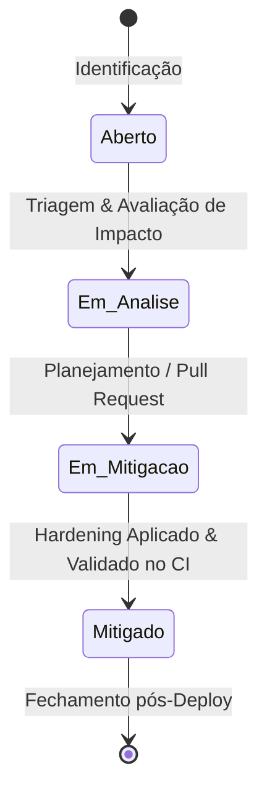

# Registro Vivo de Vulnerabilidades e Riscos de Segurança

> **Projeto:** REC Flight Intelligence  
> **Responsável:** Engenharia DevSecOps  
> **Status:** Ativo / Em Monitoramento Contínuo  
> **Última Atualização:** Novembro de 2026  

---

## 1. Visão Geral e Propósito

Este documento funciona como o **Security Tracking Board** (Registro Vivo) do monorepo REC Flight Intelligence. Qualquer vulnerabilidade detectada por ferramentas automatizadas (SAST, SCA, DAST, Secret Scanning) ou mapeada em revisões manuais de código e modelagem de ameaças deve ser catalogada aqui.

### Ciclo de Vida de uma Vulnerabilidade

### Classificação de Severidade (CVSS v3.1 Simplificado)
* **Crítica (9.0 - 10.0):** Execução remota de código (RCE), vazamento irrestrito de banco ou credenciais de produção.
* **Alta (7.0 - 8.9):** Containers rodando como `root`, portas de banco/cache expostas publicamente sem senha, vulnerabilidades conhecidas com exploit público.
* **Média (4.0 - 6.9):** CORS irrestrito (`*`), ausência de cabeçalhos de proteção (`helmet`), falta de rate limiting ou validação de entrada sem sanitização.
* **Baixa (0.1 - 3.9):** Informações de versão em cabeçalhos HTTP, avisos informativos de linter e dependências de build sem impacto em produção.

---

## 2. Matriz Viva de Vulnerabilidades

| ID | Componente / Onde | Descrição do Risco | OWASP Top 10 | Severidade | Status | Mitigação Planejada |
| :--- | :--- | :--- | :--- | :---: | :---: | :--- |
| **`SEC-001`** | `apps/api/src/main.ts` | CORS aberto para qualquer origem (`*`) e ausência de cabeçalhos HTTP defensivos (sem `helmet`). | A05:2021 Security Misconfiguration | **Média** | `Aberto` | Restringir CORS à URL do frontend e instalar middleware `helmet`. |
| **`SEC-002`** | `docker-compose.yml` | Portas do PostgreSQL (`5432`) e Redis (`6379`) expostas no host; credenciais padrão (`rec:rec`) em texto puro; Redis sem senha. | A07:2021 Identification & Auth Failures | **Alta** | `Mitigado` | Portas vinculadas a `127.0.0.1`, rede isolada `flight-network`, Redis com `--requirepass`, `no-new-privileges` e `.env.example`. |
| **`SEC-003`** | `apps/ml/Dockerfile` / `main.py` | Container FastAPI executando como usuário `root` (UID 0) com desserialização de modelos via `joblib.load()`. | A08:2021 Software & Data Integrity | **Alta** | `Aberto` | Criar usuário sem privilégios (`appuser`) no Dockerfile e restringir permissões no diretório `/app`. |
| **`SEC-004`** | Monorepo (`package.json`) | 239 vulnerabilidades em dependências de terceiros identificadas via `pnpm audit` (8 críticas, 105 altas). | A06:2021 Vulnerable & Outdated Components | **Alta** | `Aberto` | Executar auditoria direcionada (SCA), isolar dependências de dev/build e atualizar pacotes com patches. |
| **`SEC-005`** | `.github/workflows/ci.yml` | Ausência de Security Gates automatizados no pipeline (sem SAST, SCA e Secret Scanning). | A05:2021 Security Misconfiguration | **Média** | `Aberto` | Adicionar jobs no GitHub Actions com Gitleaks (segredos), Semgrep (SAST) e pnpm audit/Trivy (SCA). |
| **`SEC-006`** | `apps/api` (WebSocket) | Gateway Socket.io sem controle de taxa (*Rate Limiting*) ou autenticação para inscrição em salas. | A04:2021 Insecure Design | **Média** | `Aberto` | Implementar limitação de conexões simultâneas e validação de payload em eventos de join. |

---

## 3. Detalhamento Técnico das Vulnerabilidades

### `SEC-001`: CORS Irrestrito e Ausência de Cabeçalhos de Segurança
* **Local:** `apps/api/src/main.ts:10-11`
* **Impacto:** Qualquer site externo malicioso aberto pelo usuário pode emitir chamadas autenticadas ou consultar a telemetria privada via fetch.
* **Critério de Aceite da Correção:**
  1. `app.enableCors({ origin: process.env.FRONTEND_URL, credentials: true })`.
  2. Inclusão de `app.use(helmet())`.
  3. Teste automatizado validando a presença dos cabeçalhos `X-Content-Type-Options: nosniff` e bloqueio de origens não autorizadas.

---

### `SEC-002`: Credenciais Expostas e Portas Públicas de Infraestrutura
* **Local:** `docker-compose.yml:27,48-58`
* **Impacto:** Caso a máquina virtual ou droplet em nuvem tenha a porta 5432 ou 6379 exposta na interface de rede pública (`0.0.0.0`), atacantes conseguem varreduras automatizadas, acesso ao banco de dados e injeção de dados no Redis.
* **Critério de Aceite da Correção:**
  1. Alterar portas para escuta interna exclusiva na rede virtual do Docker (`networks: - flight-network`), removendo o bloco `ports: 5432:5432` em produção.
  2. Criar `.env.example` e documentar a rotação de senhas.
  3. Configurar comando `--requirepass ${REDIS_PASSWORD}` no Redis e repassar a URL protegida para a API.

---

### `SEC-003`: Container de Machine Learning Executando como Root
* **Local:** `apps/ml/Dockerfile` e `apps/ml/app/main.py`
* **Impacto:** O endpoint `/predict` desserializa modelos `.joblib`. Se houver comprometimento de artefatos ou exploração de falhas em bibliotecas como `numpy`/`scikit-learn`, o atacante obtém um shell interativo com UID 0 (root), viabilizando escape de container.
* **Critério de Aceite da Correção:**
  1. Inclusão de `RUN useradd -m -u 1001 appuser && USER appuser` no `apps/ml/Dockerfile`.
  2. Validação de integridade (checksum SHA-256) do arquivo `model.joblib`.
  3. Execução do container em modo read-only no sistema de arquivos raiz, se aplicável.

---

### `SEC-004`: Auditoria de Dependências de Terceiros (SCA)
* **Local:** Raiz do monorepo e `pnpm-lock.yaml`
* **Impacto:** Bibliotecas com vulnerabilidades conhecidas (CVEs catalogadas) podem ser exploradas para ataques de DoS ou injeção de protótipo (Prototype Pollution).
* **Critério de Aceite da Correção:**
  1. `pnpm audit --prod` deve retornar 0 vulnerabilidades de severidade Alta ou Crítica nos pacotes empacotados para produção.
  2. Resoluções forçadas de versões (*overrides/resolutions*) em `package.json` para pacotes transitivos com correção disponível.

---

### `SEC-005`: Pipeline de CI/CD sem Barreiras de Segurança (Security Gates)
* **Local:** `.github/workflows/ci.yml`
* **Impacto:** Código com falhas óbvias ou segredos comitados (chaves OpenSky, tokens de API, senhas) chega à branch `main` e ao ambiente de produção sem ser barrado.
* **Critério de Aceite da Correção:**
  1. Step de **Secret Scanning** com Gitleaks bloqueando commits que contenham chaves privadas.
  2. Step de **SAST** com Semgrep analisando regras de segurança para TypeScript e Python.
  3. Step de **SCA** falhando a build se novas dependências com severidade crítica forem introduzidas.

---

## 4. Histórico de Auditoria e Fechamentos

| Data | ID | Ação Realizada | Autor / Commit |
| :--- | :---: | :--- | :--- |
| 23/11/2026 | `SEC-000` | Correção de falha de lint no CI (`approachKey` não utilizado) liberando a base de testes automatizados. | Jonas / `0ef6d51` |
| 26/11/2026 | Todos | Criação formal da Matriz Viva de Riscos e abertura dos itens `SEC-001` a `SEC-006`. | Equipe DevSecOps |
| 26/11/2026 | `SEC-002` | Hardening de Infraestrutura: restrição de portas para `127.0.0.1`, isolamento na rede `flight-network`, autenticação no Redis e criação do `.env.example`. | Equipe DevSecOps |
